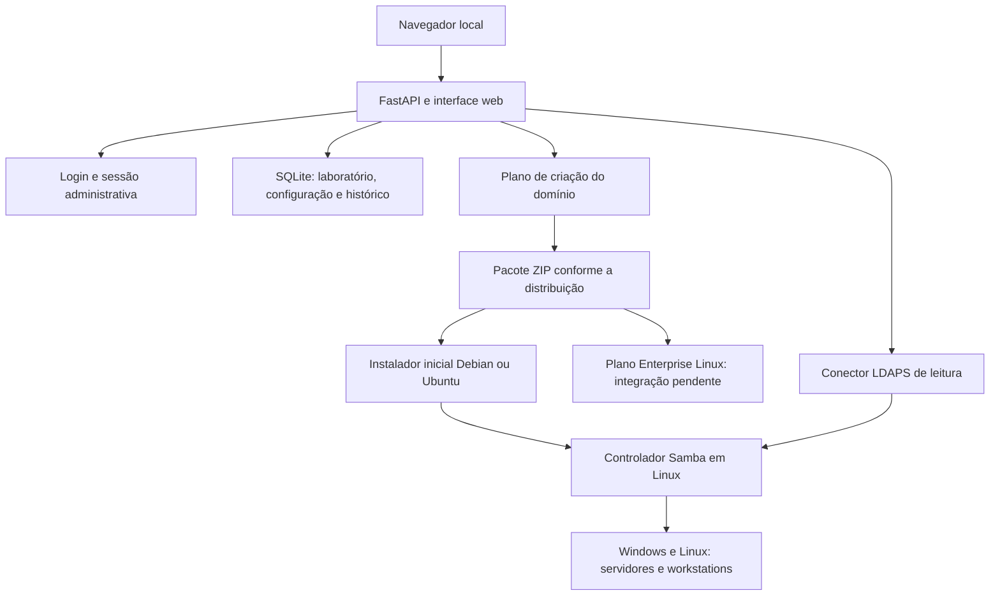

# Arquitetura inicial

## Escopo confirmado

Criar, configurar e administrar um domínio local com controladores Samba em Linux. Windows e Linux podem participar como servidores e workstations membros. Administração diária e criação do domínio devem ser facilitadas pelo navegador.

O desenvolvimento é local e independente dos projetos existentes. Nenhum domínio de cliente foi selecionado como laboratório.

## Componentes desta entrega

### Aplicação web

- FastAPI com interface HTML/CSS e JavaScript em módulos, sem dependência de CDN.
- API protegida por sessão local e token CSRF nas operações autenticadas de escrita.
- Cookie HttpOnly/SameSite, limites de tentativas no login, validação de Host e Origin.
- Dados de exemplo explicitamente identificados como laboratório.
- Entradas e saídas de erro controladas para evitar incluir senhas em mensagens de validação.
- O servidor web não recebe direitos root e não executa comandos de provisionamento.

### Laboratório persistido

- SQLite local, diretório 0700 e banco 0600.
- Alterações de objetos e seus eventos de auditoria são gravados na mesma transação.
- Restrições para nomes e logins duplicados; associações impedem exclusões inconsistentes.
- OUs têm validação de ciclos. Renomear OU com objetos associados exige movimentá-los antes.
- O banco de exemplo não constitui backup de domínio Samba.
- Auditoria local não é imutável contra o administrador do host. Exportação externa e retenção fazem parte das próximas entregas.

### Provisionamento

- Catálogo central em `app/distributions.py`, consultado por validação, API, interface e geração de pacotes.
- Instalador inicial: Debian 13 e Ubuntu 24.04/26.04 LTS, com pacotes da distribuição.
- Perfis Red Hat, Oracle Linux, AlmaLinux e Rocky Linux 9 geram manifesto e plano; o instalador específico ainda está pendente.
- O pacote nativo inclui o catálogo; o instalador recusa distribuição/versão diferente do manifesto e destinos sem adaptador.
- Assistente valida nome DNS, nome curto, hostname, IPv4, CIDR, encaminhador DNS e fonte de horário.
- Plano e pacote contêm somente configuração, sem senha Administrator.
- Instalador pede confirmação e senha no console da VM.
- O provisionamento usa `samba-tool` em terminal interativo; senha não é passada em argv.
- Pré-requisitos recusam outro sistema, ausência de root, IP ausente/dinâmico e estado de domínio existente.
- Backups dos arquivos alterados ficam em diretório root protegido; snapshot/backup da VM é requisito do fluxo.
- A instalação interrompe em falha. Não há retomada nem rollback automático de banco Samba parcial nesta versão.
- Firewall, emissão de certificados, segundo DC, ingresso de membros e recuperação completa ainda não são automatizados.

### Consulta ao domínio

- LDAP exclusivamente sobre TLS, com validação de certificado e hostname.
- Conta de consulta fornecida pelo administrador para o domínio selecionado.
- Credenciais somente em memória por sessão, com expiração, desconexão e descarte no encerramento.
- Conector utiliza `read_only=True`, não segue referências para outros servidores e consulta usuários, grupos, OUs, computadores e GPOs com paginação.
- No modo conectado, a API recusa escritas nos cadastros de laboratório.
- Consultas reais não usam os objetos fictícios para completar resultados ausentes.
- Contas de computador não são telemetria de disponibilidade, inventário do sistema instalado ou prova de ingresso saudável.

## Decisões para a próxima etapa

1. Ambiente de execução e instalação do controlador em uma VM nova.
2. APIs de escrita Samba com identidade delegada, autorização por operação e auditoria de antes/depois.
3. Identidade administrativa central, MFA, perfis e acesso por OU.
4. Conectores específicos para DNS, SYSVOL e servidores de arquivos.
5. Catálogo de políticas e matriz de suporte por sistema/versão do membro.
6. Replicação do diretório e distribuição do SYSVOL como operações distintas.
7. Canal autenticado para ingresso assistido, hostname e tarefas nos membros.
8. Recuperação, atualizações, instalação reproduzível e verificação operacional em laboratório.
9. Banco e tarefas em múltiplos processos: substituir o armazenamento de credenciais por sessão em memória quando a arquitetura precisar de múltiplos workers.

## Estado de validação

Código e dependências preparados nesta atividade. Nenhum teste automatizado foi adicionado ou executado. Conector LDAPS, instalador e políticas ainda não foram validados contra uma VM/domain real.
